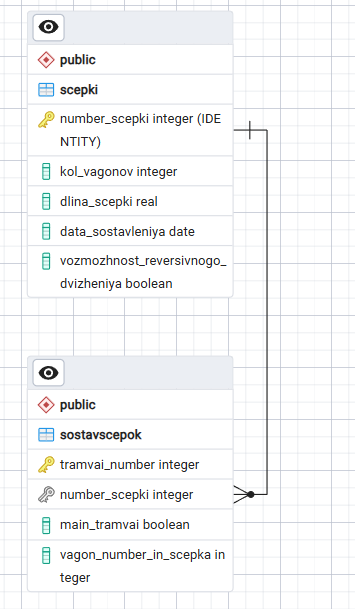
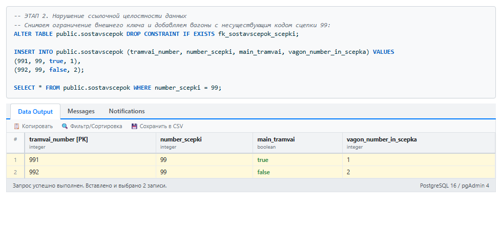
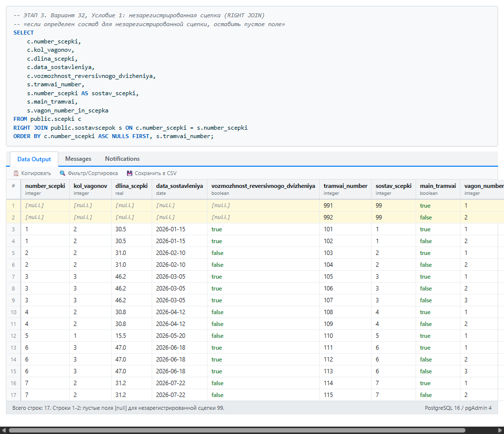
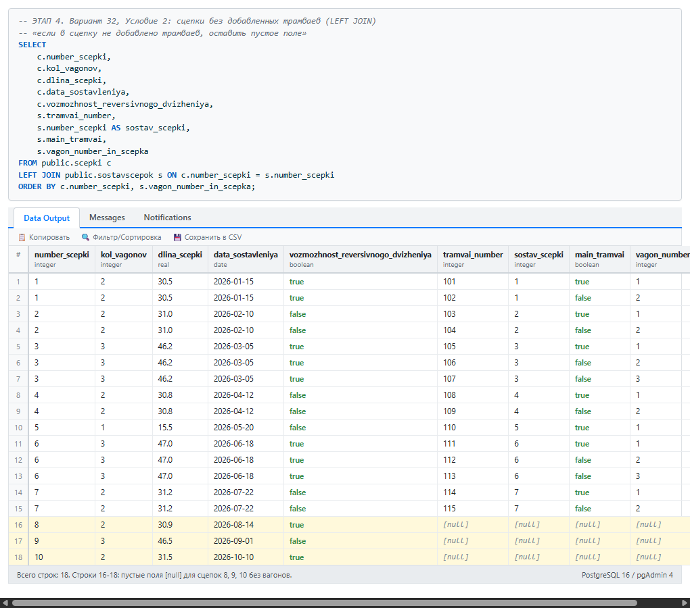
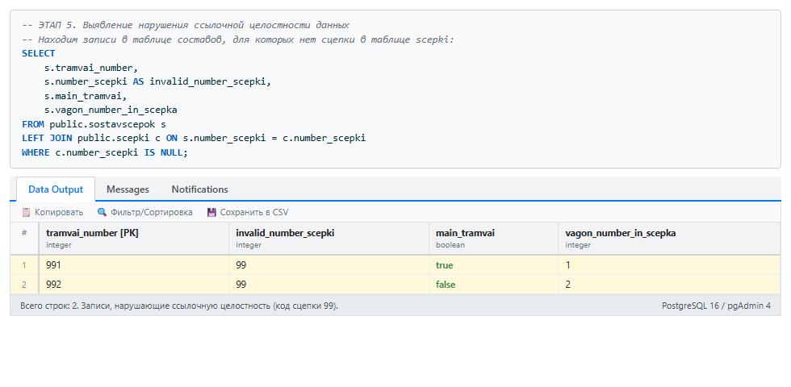

# Лабораторная работа №3: Межтабличные связи

**Вариант 32**

---

## 1. Постановка задачи варианта 32

Вывести на экран информацию обо всех сцепках и их составах при условии, что:
1. **Условие 1:** если определен состав для незарегистрированной сцепки, оставить пустое поле;
2. **Условие 2:** если в сцепку не добавлено трамваев, оставить пустое поле.

---

## 2. Предметная область и схема данных

База данных включает две связанные таблицы:
* **`public.scepki` (Главная таблица)**:
  * `number_scepki` (INT, Первичный ключ / PK) — номер сцепки;
  * `kol_vagonov` (INT) — количество вагонов;
  * `dlina_scepki` (REAL) — общая длина сцепки в метрах;
  * `data_sostavleniya` (DATE) — дата формирования сцепки;
  * `vozmozhnost_reversivnogo_dvizheniya` (BOOLEAN) — признак возможности реверсивного движения.

* **`public.sostavscepok` (Зависимая / подчиненная таблица)**:
  * `tramvai_number` (INT, Первичный ключ / PK) — бортовой номер трамвая (вагона);
  * `number_scepki` (INT, Внешний ключ / FK) — ссылка на родительскую сцепку `scepki(number_scepki)`;
  * `main_tramvai` (BOOLEAN) — признак головного (ведущего) вагона;
  * `vagon_number_in_scepka` (INT) — порядковый номер вагона в сцепке.

Связь между таблицами: `1 : M` (одна сцепка может содержать несколько вагонов). Ограничение внешнего ключа: `fk_sostavscepok_scepki`.



---

## 3. Выполнение этапов лабораторной работы

Скрипт со всеми запросами: [`requests.sql`](requests.sql).

### Этап 1. Проверка обеспечения ссылочной целостности данных
В исходном состоянии внешний ключ `fk_sostavscepok_scepki` обеспечивает целостность данных. При выполнении симметричного соединения (`INNER JOIN`) выводятся только те строки, для которых существует строгое соответствие в обеих таблицах (сцепки с 1 по 7):

```sql
SELECT 
    c.number_scepki,
    c.kol_vagonov,
    c.dlina_scepki,
    c.data_sostavleniya,
    c.vozmozhnost_reversivnogo_dvizheniya,
    s.tramvai_number,
    s.number_scepki AS sostav_scepki,
    s.main_tramvai,
    s.vagon_number_in_scepka
FROM public.scepki c
INNER JOIN public.sostavscepok s ON c.number_scepki = s.number_scepki
ORDER BY c.number_scepki, s.vagon_number_in_scepka;
```

---

### Этап 2. Нарушение ссылочной целостности данных
Для моделирования нарушения целостности временно снимается ограничение внешнего ключа, после чего в таблицу составов добавляются вагоны 991 и 992 с несуществующим кодом сцепки `99`:

```sql
ALTER TABLE public.sostavscepok DROP CONSTRAINT IF EXISTS fk_sostavscepok_scepki;

INSERT INTO public.sostavscepok (tramvai_number, number_scepki, main_tramvai, vagon_number_in_scepka) VALUES
(991, 99, true, 1),
(992, 99, false, 2);
```



---

### Этап 3. Запрос по Условию 1 Варианта 32 (Правостороннее соединение `RIGHT JOIN`)
**Требование:** «если определен состав для незарегистрированной сцепки, оставить пустое поле».

В данном запросе сохраняются все строки правой таблицы `sostavscepok`. Для добавленных вагонов 991 и 992, у которых сцепка `99` отсутствует в главной таблице `scepki`, все поля сцепки остаются пустыми (`NULL`):

```sql
SELECT 
    c.number_scepki,
    c.kol_vagonov,
    c.dlina_scepki,
    c.data_sostavleniya,
    c.vozmozhnost_reversivnogo_dvizheniya,
    s.tramvai_number,
    s.number_scepki AS sostav_scepki,
    s.main_tramvai,
    s.vagon_number_in_scepka
FROM public.scepki c
RIGHT JOIN public.sostavscepok s ON c.number_scepki = s.number_scepki
ORDER BY c.number_scepki ASC NULLS FIRST, s.tramvai_number;
```



---

### Этап 4. Запрос по Условию 2 Варианта 32 (Левостороннее соединение `LEFT JOIN`)
**Требование:** «если в сцепку не добавлено трамваев, оставить пустое поле».

В данном запросе сохраняются все строки левой таблицы `scepki`. Для сцепок 8, 9 и 10, в которые не включено ни одного вагона, все поля состава остаются пустыми (`NULL`):

```sql
SELECT 
    c.number_scepki,
    c.kol_vagonov,
    c.dlina_scepki,
    c.data_sostavleniya,
    c.vozmozhnost_reversivnogo_dvizheniya,
    s.tramvai_number,
    s.number_scepki AS sostav_scepki,
    s.main_tramvai,
    s.vagon_number_in_scepka
FROM public.scepki c
LEFT JOIN public.sostavscepok s ON c.number_scepki = s.number_scepki
ORDER BY c.number_scepki, s.vagon_number_in_scepka;
```



---

### Этап 5. Выявление нарушения ссылочной целостности данных
Запрос соединяет подчиненную таблицу `sostavscepok` с главной `scepki` и фильтрует записи по признаку отсутствия соответствия (`WHERE c.number_scepki IS NULL`). Это позволяет обнаружить записи-«сироты», противоречащие ссылочной целостности:

```sql
SELECT 
    s.tramvai_number,
    s.number_scepki AS invalid_number_scepki,
    s.main_tramvai,
    s.vagon_number_in_scepka
FROM public.sostavscepok s
LEFT JOIN public.scepki c ON s.number_scepki = c.number_scepki
WHERE c.number_scepki IS NULL;
```



---

### Этап 6. Восстановление ссылочной целостности
Для приведения БД в исходное состояние удаляются некорректные записи и повторно накладывается внешний ключ:

```sql
DELETE FROM public.sostavscepok
WHERE number_scepki NOT IN (SELECT number_scepki FROM public.scepki);

ALTER TABLE public.sostavscepok
ADD CONSTRAINT fk_sostavscepok_scepki FOREIGN KEY (number_scepki)
    REFERENCES public.scepki (number_scepki)
    ON UPDATE CASCADE
    ON DELETE CASCADE;
```

*(Команды восстановления в `requests.sql` закомментированы, чтобы тестовые данные сохранялись при проверке преподавателем).*

---

## 4. Чек-лист выполнения работы

- [x] **Ссылочная целостность данных нарушена**: временно снят FK и добавлены вагоны 991, 992 с кодом сцепки 99.
- [x] **Сохранены скрипты с запросами на левостороннее и правостороннее соединения**: запросы по условиям 1 и 2 варианта 32 оформлены в `requests.sql`.
- [x] **Отличия видов соединений ясны**:
  - `INNER JOIN` (симметричное) — возвращает только пересечение множеств (строки, имеющие пару в обеих таблицах).
  - `RIGHT JOIN` (правостороннее) — сохраняет все строки подчиненной таблицы, заполняя поля главной таблицы `NULL`, если связь отсутствует (демонстрирует нарушение целостности / условие 1).
  - `LEFT JOIN` (левостороннее) — сохраняет все строки главной таблицы, заполняя поля подчиненной таблицы `NULL`, если у сцепки нет вагонов (демонстрирует отсутствие дочерних записей / условие 2).
- [x] **Определен запрос, выявляющий нарушение ссылочной целостности данных**: реализован через `LEFT JOIN ... WHERE c.number_scepki IS NULL`.
- [x] **Ссылочная целостность данных восстанавливается**: подготовлены команды очистки некорректных записей и возврата ограничения внешнего ключа.
